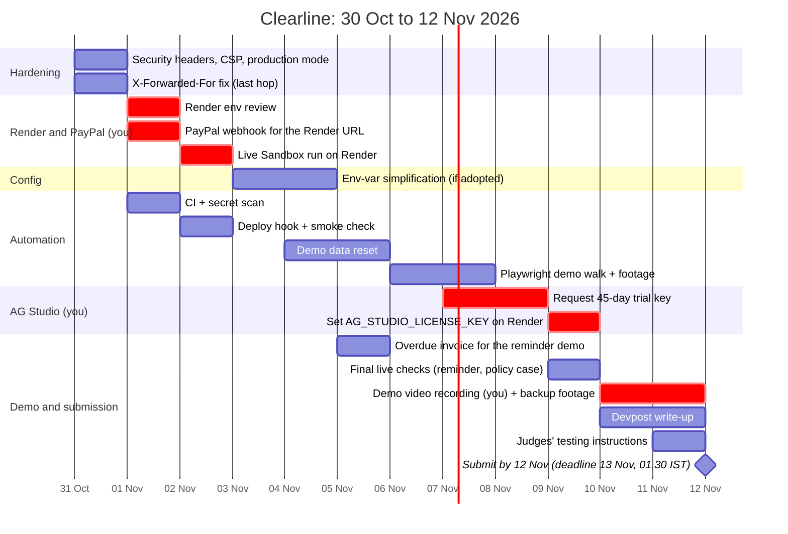

# Clearline: status, live check, automation and plan

How the system works is in [SYSTEM.md](SYSTEM.md). This page is the honest state of things on
30 Oct 2026 (commit `f3132a9`), and what's left before the deadline: **13 Nov 2026,
1:30 AM IST** (12 Nov, 20:00 UTC).

## 8. Status matrix

- **Built:** the commit that added it.
- **Tested offline:** tests that pass with PayPal and the AI mocked. 283 in total, all
  passing on SQLite; 110 + 1 skipped of them also pass on Postgres (Neon dev branch).
- **Live in Sandbox:** tested by hand against PayPal Sandbox.
- **On Render:** what was checked on `https://clearline-cbyb.onrender.com` (section 9).

| Feature | Built | Tested offline | Live in Sandbox | On Render | Notes |
|---|---|---|---|---|---|
| Checkout, capture | `5182e43` | `test_flow`, `test_webhooks` | Yes | Not verified | Server-side price catalogue |
| Mark shipped (tracking) | `5182e43` | `test_flow` | Yes | Not verified | |
| Verified webhooks | `5182e43` | `test_webhooks` (10) | Yes (via ngrok) | Not verified | Render has a webhook ID set; no delivery seen yet |
| Dispute sync (button; every 3 min) | `0959b11`; auto `0c36ca0` | `test_sync_sandbox` (11) | Yes | Yes | Render's auto-sync listed 4 disputes and 1 invoice, no errors |
| AI dispute recommendation | `0959b11` | `test_assistant` (21), `test_ai` (10) | Yes | Not verified | Sticky Gemini to Groq fallback |
| FIGHT on an inquiry (evidence, message skipped) | `2396d25` | `test_assistant` | Yes | Not verified | Evidence first, re-check before each step |
| Chargeback document evidence | `31546d2` | `test_documents` (24) | Yes (`PROOF_OF_DELIVERY_SIGNATURE` + PDF) | Not verified | Files never stored |
| Buyer page and partial refund | `b4d72dc` | `test_buyer` (17) | Yes (40 USD partial) | Not verified | |
| Invoices: AI draft, create, send, paid | `15b1e0d` | `test_invoices` (20) | Yes (300 USD paid) | Data visible | |
| India export checklist | `15b1e0d` | `test_invoices` | Yes | Data visible | Purpose code, FIRA |
| Invoice reminders (overdue) | `15b1e0d` | `test_invoices` | **No** | No | Needs an invoice that is actually overdue |
| MCP buyer agent + auto-refund | `997cc35` | `test_agents` (20) | Yes (120 USD instant) | MCP answers `initialize` | |
| Auto-policy negative case (shipped order) | `997cc35` | `test_agents` | **No** | No | Covered offline only |
| MCP merchant tools + agent keys | `997cc35`, `e0c36e5` | `test_agents`, `test_auth` | No | No keys created yet | Read-only |
| UI design system, the clear line | `68e9f58` | `test_seller_page` (14) | Yes | Yes (screenshots) | |
| Money in flight dashboard (AG Grid) | `5f87977` | `test_dashboard` (9) | Yes | Yes (screenshot) | |
| Insights (AG Studio) | `8997fe7` | `test_insights` (16) | Yes | Yes (watermark: no licence key) | |
| Insights AI (Gemini, Groq) | `ab00cf3` to `1a8de5b` | `test_insights_ai` (34) | Yes ("needs me this week", bar chart) | Not verified | |
| Seller accounts, sessions, /setup, CLI | `e0c36e5` | `test_auth` (59) | Locally | **Yes** (login, redirects, `/setup` 404, Secure cookie) | Judge account works |
| Postgres (Neon), migration, `/healthz` | `f3132a9` | `test_db` (11), `test_migrate` (5) + the Postgres run | n/a | **Yes** (`/healthz` ok) | Data copied: 102 rows |
| Checkout on Render | | | | **No** | Not tried |

## 9. Live deployment check (30 Oct 2026, read-only)

These checks were read-only, apart from logging the judge account in and out. Nothing was sent
to PayPal by these checks.

| Check | Result |
|---|---|
| Cold start | Already awake: `/healthz` answered in 1.4 s |
| `GET /healthz` | 200 `{"ok":true,"db":"ok"}`, `Cache-Control: no-store` |
| `GET /login` | 200, HTML |
| `GET /seller` without a session | 303 to `/login` |
| `GET /docs` without a session | 303 to `/login` |
| `GET /api/orders` without a session | 401 "Log in as the seller first." |
| `GET /setup` | 404 (accounts exist) |
| `http://` | 301 to `https://` |
| MCP `initialize` | 200, server instructions returned |
| Judge login | 200; cookie `HttpOnly; SameSite=lax; Secure; Path=/; Max-Age=30 days` |
| `/seller`, `/dashboard`, `/insights` as the judge | All render with the copied data (8 orders and invoices, KPIs, charts). Screenshots: `D:\Temp\claude\clearline\shots\live-*.png` |
| Security headers | None: no CSP, HSTS, `X-Frame-Options` or `X-Content-Type-Options` |
| AI provider | Gemini active (`/api/ai/status`) |
| AG Studio licence | Not set (`/api/insights/license` returns no key); the trial watermark shows |
| Agent keys | None yet (`merchant_enabled: false`) |

**What the behaviour shows about configuration:**

- **`PAYPAL_WEBHOOK_ID` is set.** An empty `{}` POST to `/webhooks/paypal` got 400 "Not a
  PayPal webhook event". Without the ID it would be 503, before the body is read. No real
  webhook delivery to Render has been seen yet.
- **`TRUST_PROXY` is on.** The session cookie is `Secure` even though Render talks to the app
  over plain HTTP.
- **PayPal credentials work.** Auto-sync ran: 4 disputes and 1 invoice listed, no errors.
- **`DATABASE_URL` points at Neon.** `/healthz` is ok, and the judge account (created on Neon)
  logs in.

## 10. Automation proposals

| # | Automation | What it does | Effort | Demo value |
|---|---|---|---|---|
| 1 | **CI on GitHub Actions** | Every push: the full test suite on SQLite, plus the database tests against a Postgres service container. Fails fast | S | High: no broken deploys during the last two weeks |
| 2 | **Secret scan in CI** | Fails the build if a diff has a Neon host name, a Postgres connection string, an agent key, or PayPal or AI key patterns. Same check as a local pre-commit hook | S | High: one leak would be costly |
| 3 | **Pre-demo check command** (`python -m app.smoke <url>`) | Wakes Render and waits out the cold start. Checks `/healthz`, `/login`, that `/setup` is 404, a judge login, AI provider status, whether the AG Studio key is present, and webhook readiness (the `{}` probe). Prints one green/red table | S | High: run it 10 minutes before judging |
| 4 | **Deploy pipeline** | Turn off Render auto-deploy; CI calls Render's deploy hook only after tests pass, then runs the smoke check (3) against the live URL | S–M | High: a red deploy never reaches judges |
| 5 | **Demo data reset on Neon** (`python -m app.demo_reset`) | Rebuilds one fresh "demo story": an order to ship, an open buyer request, an inquiry dispute waiting on the seller, an overdue invoice, an agent refund. Refuses to run without a flag and a backup | M | High: every demo starts from the same story |
| 6 | **Playwright demo walk** | Walks the story on the live site (login, today, dispute card, buyer page, dashboard, Insights AI question), recording video and screenshots | M | High: backup footage if Sandbox or Wi-Fi fails |
| 7 | **Screenshot script in the repo** | Move the screenshot script into `tools/`, with a `--live` mode, for README and Devpost images in light and dark at phone and desktop widths | S | Medium |
| 8 | **Faster tests** | Run with `pytest -n auto` (xdist) on SQLite. For Postgres, share one schema per test file, or run in CI next to the database (each query costs about 270 ms from India) | S | Medium: today SQLite takes 3 min, Postgres 27 min |
| 9 | **Webhook readiness** | Use Render's URL for PayPal webhooks, so no local tunnel is needed for the demo. A small script lists the app's PayPal webhooks (read-only) and checks the Render URL is subscribed | S | Medium |
| 10 | **Windows dev friction** | A `dev.ps1` that starts uvicorn and ngrok with the right paths (ngrok once went missing from `tools\`), and can add a Defender exclusion for `.venv`, `tools` and the pytest temp folder (needs admin). Exclusions keep scans away from `ngrok.exe` and make installs and test runs quicker | S | Low–medium |

**What the demo reset can and can't create.** PayPal ids must be real for any later action:

| Story item | How |
|---|---|
| Order to ship | Real: create the order through the API. The buyer approves in the Sandbox window, so this needs a Playwright login to the Sandbox buyer account, then capture |
| Buyer request | Real: through the buyer link (Clearline only, no PayPal call) |
| Agent refund | Real: MCP `request_refund` with the policy on (a Sandbox refund) |
| Inquiry dispute | **Can't be created by the API.** The buyer opens it in the Sandbox Resolution Center (manual, or Playwright on the buyer account). Seeded events can show it, but Approve would fail on a fake id |
| Overdue invoice | **Can't be overdue on day one.** PayPal won't take a past due date, so create it with the shortest term a few days before the demo and wait. Or seed it for display only, knowing Remind would fail |
| Paid invoice, resolved dispute | Real only after buyer actions in Sandbox |

Seeded rows must use ids that PayPal never sees, and must be marked as demo data so no button
fires a PayPal call on them.

## 11. Plan to submission

| Item | Who | Blocked on you? |
|---|---|---|
| Headers, CSP, production mode, X-Forwarded-For fix | Claude | No |
| Render environment review, PayPal webhook for the Render URL | You (Render and PayPal dashboards) | **Yes** |
| Live Sandbox run on Render (checkout, webhook, seller login) | You, with Claude checking | **Yes** (buyer approval in Sandbox) |
| Env-var simplification | Claude, if you approve the proposal | Decision only |
| CI, secret scan, deploy hook, smoke check | Claude | You add the deploy hook secret to GitHub |
| Demo data reset, Playwright walk | Claude | Sandbox buyer steps are yours |
| AG Studio 45-day trial (request on 7–8 Nov, lasts to about 22 Dec) | You (email AG Grid) | **Yes** |
| Overdue invoice for the reminder demo (create about 5 Nov, shortest term) | You click, or Claude via the app | Partly |
| Demo video | You (voice, screen) | **Yes** |
| Devpost write-up, judges' instructions | Claude drafts, you submit | Submit is yours |
