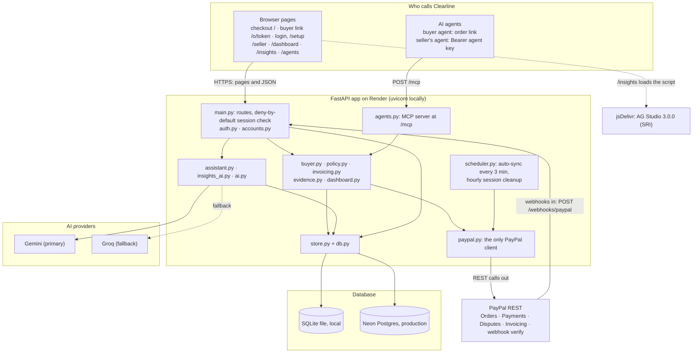
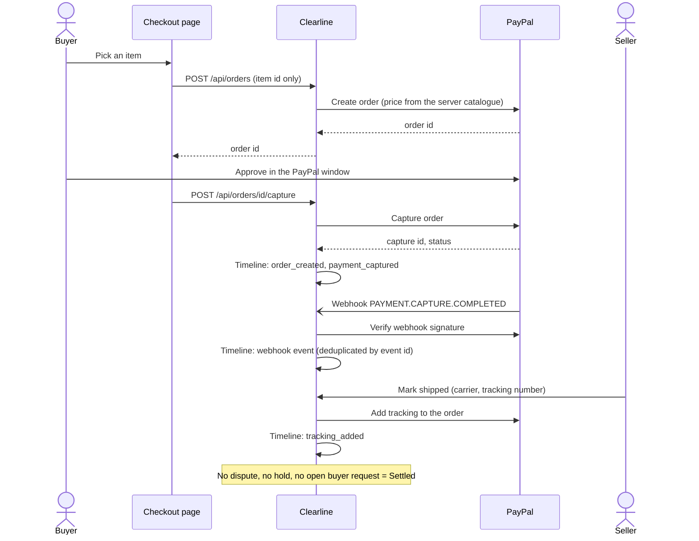
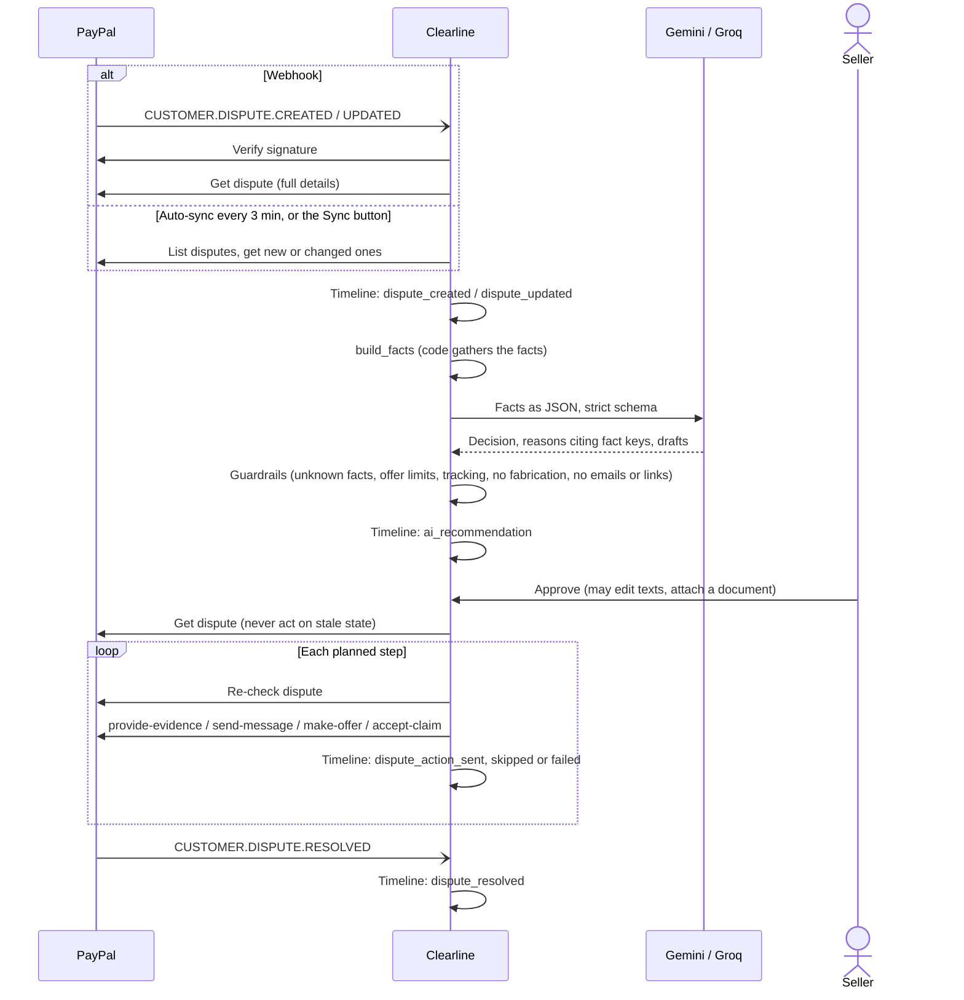
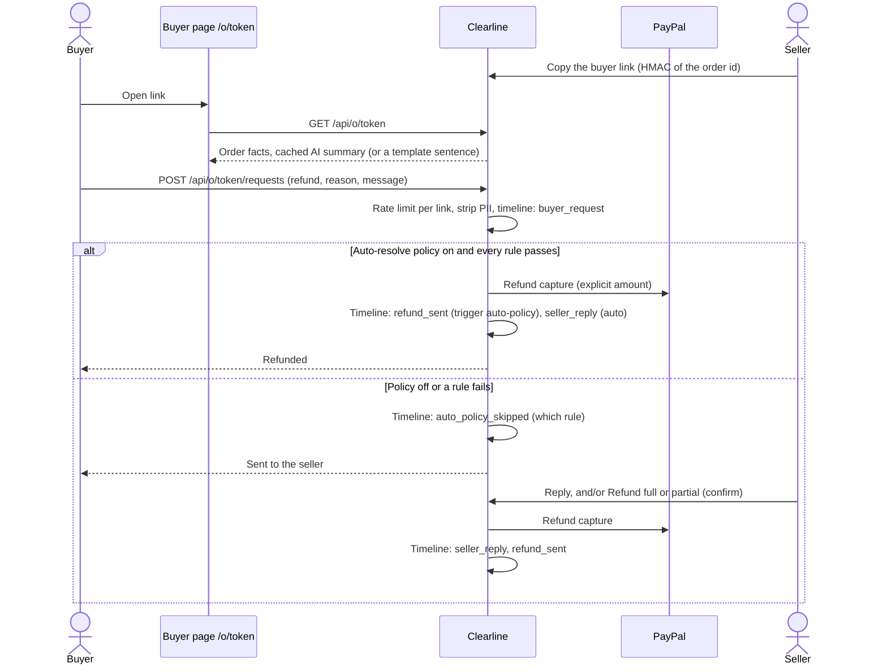
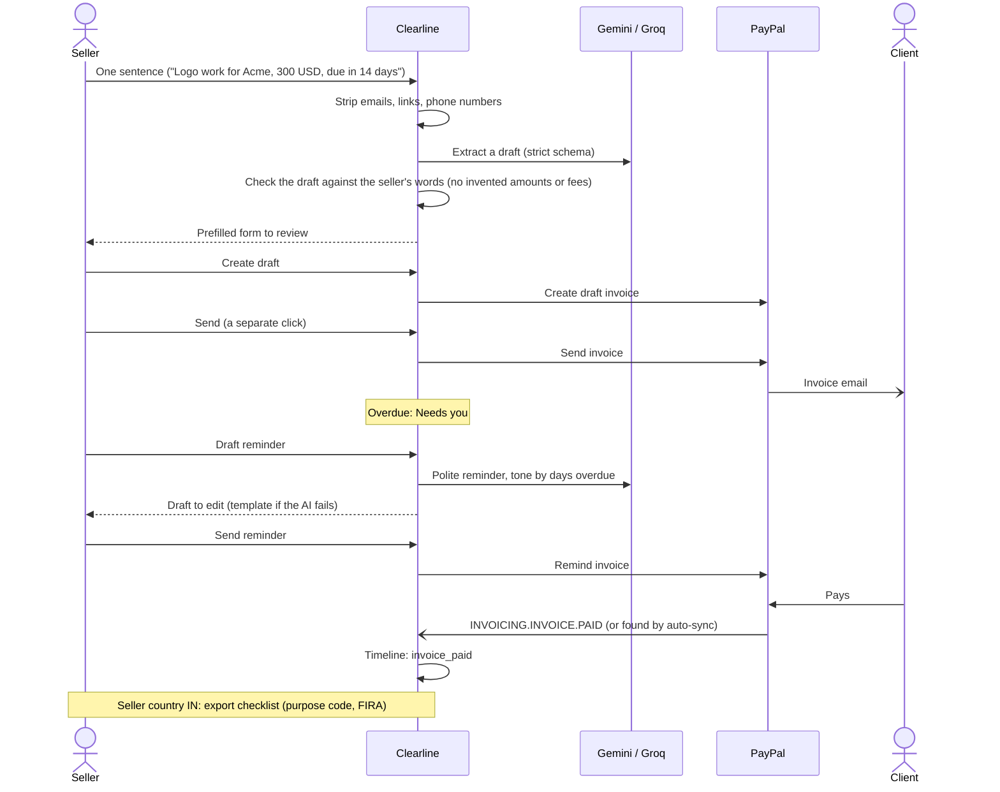
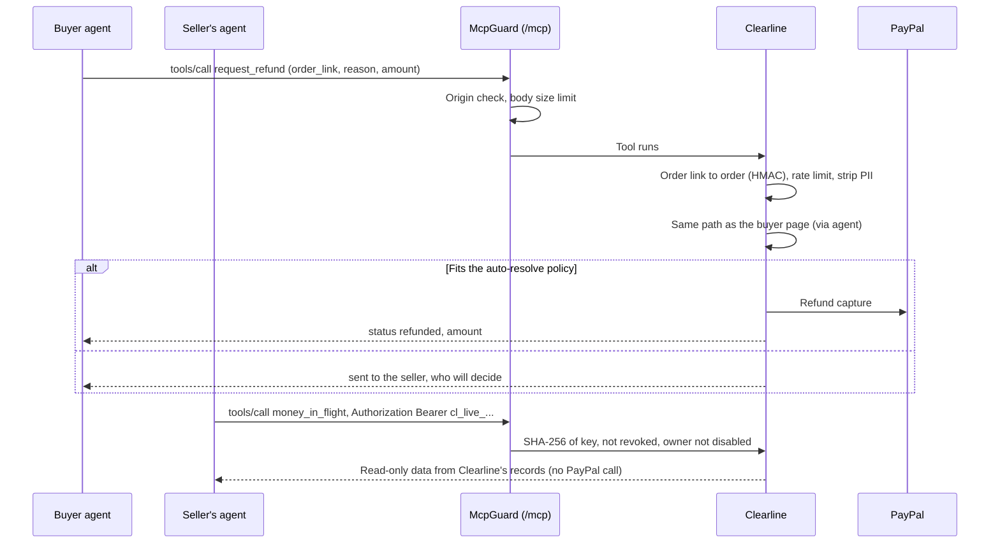
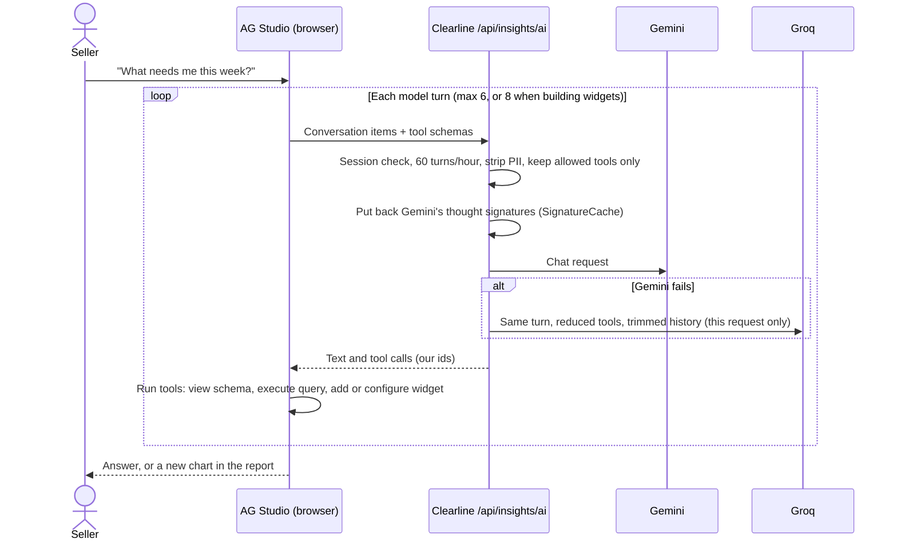
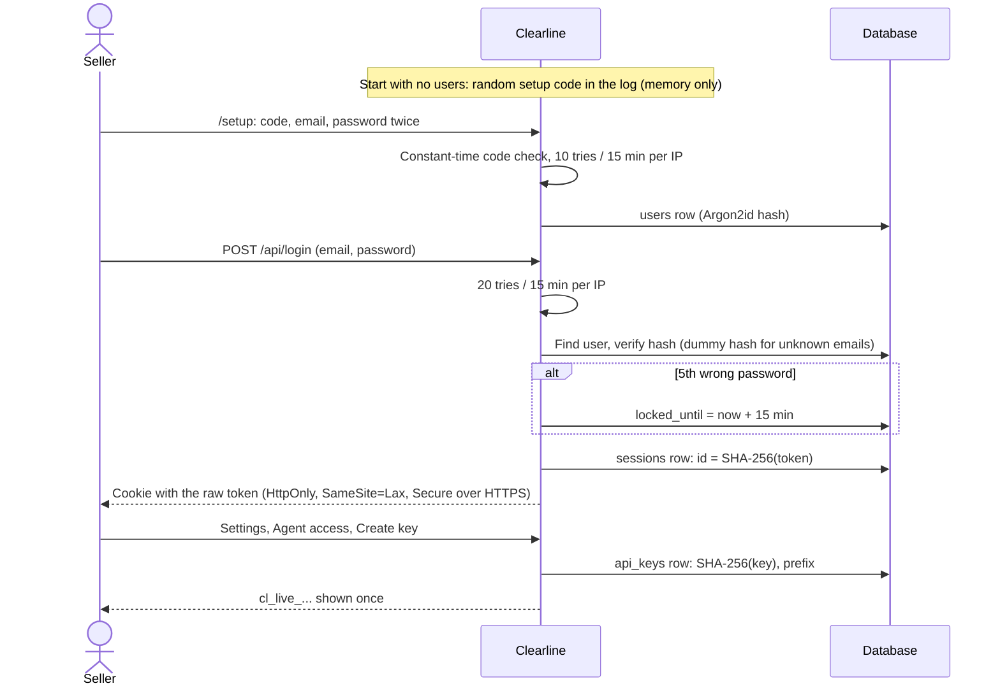
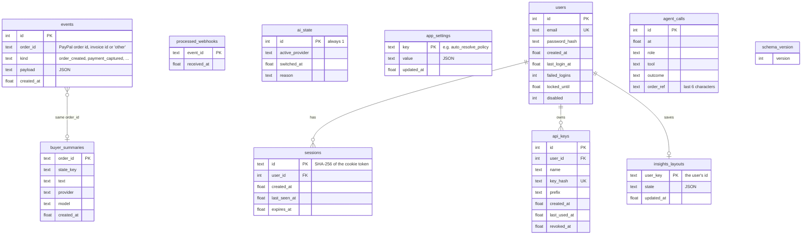

# Clearline: system guide

What Clearline is, how it is built, how money and data move through it, how it is protected,
and how it is configured. Status, the live check, automation and the plan to submission are in
[STATUS.md](STATUS.md).

Everything here was read from the code at commit `f3132a9` (30 Oct 2026).

## 1. What Clearline is

Clearline helps a small online seller who is paid through PayPal see where every payment is,
and sort out problems before they become disputes. It keeps one timeline per sale: order,
capture, shipping, buyer questions, refunds, disputes and invoices. The seller works from that
timeline. AI drafts the answers, and the seller approves every action that moves money.

| Who | What they get |
|---|---|
| Seller | `/seller` (today's to-dos, orders, disputes, invoices, settings), `/dashboard` (money in flight), `/insights` (their own report with an AI analyst) |
| Buyer | A private link per order (`/o/<token>`): what was bought, shipping, refunds, and a way to ask a question or request a refund |
| AI agents | An MCP server at `/mcp`. Buyer agents use the order link; the seller's own agent uses an agent key for read-only tools |

**Hackathon.** PayPal AI Hackathon, open track. Deadline: **13 Nov 2026, 1:30 AM IST**
(12 Nov, 20:00 UTC).

| Prize targeted | Feature that serves it |
|---|---|
| PayPal + AI | Dispute assistant: facts from PayPal, AI recommendation with server-side guardrails, seller approves, Clearline sends evidence, messages or offers. Also AI invoice drafts, reminder drafts and buyer-page summaries |
| Agentic Commerce | MCP server: a buyer's agent can check an order and request a refund; the seller's auto-resolve policy can refund instantly within caps. Read-only merchant tools for the seller's own agent |
| Demo | One clear UI ("the clear line"), a live site on Render with a judge account, and real PayPal Sandbox flows |
| AG Grid (sponsor) | `/dashboard` on AG Grid Community + AG Charts Community; `/insights` on AG Studio, with its AI assistant running through Clearline's own AI client |

## 2. Architecture

- **Hosting.** Production runs on Render (`https://clearline-cbyb.onrender.com`) with Neon
  Postgres. Locally it runs under uvicorn with a SQLite file. ngrok gives the local app a
  public URL so PayPal webhooks can reach it.
- **Calls out.** Only `paypal.py` talks to PayPal. Only `ai.py` (dispute assistant, buyer
  summaries, invoice drafts) and `insights_ai.py` (Insights analyst) talk to Gemini and Groq.
  The browser loads AG Studio from jsDelivr, pinned with an integrity hash. AG Grid and AG
  Charts are served by the app itself.
- **Calls in.** Browsers, AI agents on `/mcp`, and PayPal webhooks on `/webhooks/paypal`.
  Each webhook is verified with PayPal before it is used.
- **Background.** `scheduler.py` runs the auto-sync every `AUTO_SYNC_MINUTES` (default 3). It
  pulls disputes and invoice statuses from PayPal, as a safety net for missed webhooks. An
  hourly job deletes expired sessions.

## 3. Tech stack

| Layer | Technology + version | Why | Sponsor / licence |
|---|---|---|---|
| Language | Python 3.13.5 | One language for server, AI glue and tests | PSF |
| Web framework | FastAPI 0.162.0 on Starlette 1.10.0, Uvicorn 0.54.0 | Async, typed request models, small | MIT / BSD |
| HTTP client | httpx 0.28.1 | Async calls to PayPal and AI; mockable with respx | BSD |
| Validation, config | pydantic 2.14.1, pydantic-settings 2.16.1 | Strict models for AI answers and requests; settings from env | MIT |
| Passwords | argon2-cffi 25.1.0 (Argon2id) | Current best practice for password hashing | MIT |
| AI agents | mcp 2.3.0 (official MCP Python SDK) | Standard protocol for agents; Streamable HTTP in-process | MIT |
| Database | SQLite 3.50 (stdlib) locally; Postgres on Neon via psycopg 3.3.6 + psycopg-pool 3.3.3 | Zero setup locally; managed Postgres in production, free tier | Neon free tier; psycopg LGPL |
| Payments | PayPal REST APIs (Orders v2, Payments v2, Disputes v1, Invoicing v2, webhooks) and PayPal JS SDK v6 | The hackathon platform | PayPal Sandbox |
| AI | Gemini `gemini-3.5-flash-lite` (primary), Groq `openai/gpt-oss-120b` (fallback), both through their OpenAI-compatible endpoints | Fast, cheap, free tiers; one client for both | Provider terms |
| Grid and charts | AG Grid Community 36.2.0, AG Charts Community 14.2.0, self-hosted in `app/static/vendor/` | Sponsor; fast grid; no CDN needed | MIT (licence files alongside) |
| Report builder | AG Studio 3.0.0 from jsDelivr with SRI | Sponsor; drag-and-drop report with an AI agent framework | Commercial (AG Grid Ltd); runs as a trial with a watermark until a licence key is set |
| Font | Instrument Sans, self-hosted | Clean UI; no font CDN | SIL OFL |
| Hosting | Render web service; ngrok for local webhooks | Simple deploys; stable tunnel for Sandbox webhooks | Render free tier |
| Tests | pytest 9.1.1, respx 0.23.1 (PayPal and AI mocked); Playwright 1.64.1 for screenshots (outside the repo) | Offline tests, no credentials needed | MIT / Apache 2.0 |

## 4. Core flows

### a) Checkout, capture, shipping, settled

The price never comes from the browser. A failed capture is recorded as `capture_failed`.

### b) Dispute: webhook or sync, AI recommendation, seller approves

- FIGHT sends evidence first. Tracking is sent for inquiries; claims (`CHARGEBACK` stage) take
  only documents, such as `PROOF_OF_DELIVERY_SIGNATURE` with a PDF the seller uploads.
- A step PayPal no longer allows is skipped, not failed. There is no automatic retry.
- If Gemini looks down or its key is bad, the dispute assistant switches to Groq and stays
  there until the seller resets it (`POST /api/ai/reset`).

### c) Buyer link, refund request, policy or seller

The policy is off by default. Its rules: allowed reasons, per-order maximum, daily cap,
currency, no dispute, not shipped, and nothing left to refund. Every check runs on
Clearline's records before PayPal is called, under a lock so two requests can't both fit the
daily cap.

### d) Invoice: AI draft, send, reminder, paid

### e) AI agents on MCP

Buyer tools: `get_order_status`, `message_seller`, `request_refund`, `get_request_status`.
Merchant tools, all read-only: `list_attention_items`, `get_dispute_brief`, `money_in_flight`.
The call log keeps the tool, role, time, a short outcome and the order's last 6 characters.

### f) Insights AI

The analyst can only read and arrange the report. Studio's data comes from the same PII-free
rows as the dashboard, including `needs_you`, `deadline` and `act_by`.

### g) Login, sessions, /setup, agent keys

More accounts, password resets and disabling go through the CLI:
`python -m app.users create | reset-password | disable | enable | list`. `--password-stdin`
covers scripts. `/setup` returns 404 once any account exists.

## 5. Data model

There is no `orders` table. An order is all the `events` rows that share its `order_id`.
Every status the UI shows is computed from those rows.

The relationships are logical: there are no foreign keys. The same schema runs on SQLite and
Postgres. On Postgres, ids are `BIGINT` identities and times are `DOUBLE PRECISION` epoch
seconds. `schema_version` records how far migrations have run; they run at startup.

**Event kinds** (main ones): `order_created`, `payment_captured`, `capture_failed`,
`tracking_added`, `webhook_payment_capture_completed / pending / reversed`, `buyer_request`,
`seller_reply`, `refund_sent`, `refund_failed`, `auto_policy_skipped`, `dispute_created`,
`dispute_updated`, `dispute_resolved`, `ai_recommendation`, `dispute_action_sent / skipped /
failed`, `invoice_status`, `invoice_send_sent`, `invoice_reminder_sent`, `invoice_paid`,
`invoice_action_failed`, `export_purpose_suggested / set`, `export_fira`.

### Money states and the clear line

Every paid order or invoice is in exactly one state (`app/dashboard.py`):

| State | Label | When |
|---|---|---|
| `disputed` | Disputed | An open dispute (latest state by PayPal's `update_time`), or the capture was reversed |
| `held` | Waiting | PayPal holds the capture (pending), or a buyer request has no reply or refund yet |
| `settled` | Settled | None of the above (net of refunds) |
| `unpaid` | Unpaid / Overdue | An invoice not paid yet |

**The clear line** draws each order's history as one horizontal line. Each segment is
coloured by the money state at that time, so the seller sees where the money was and is now.
The same component (`history.js`) is used on `/seller` and in the dashboard's side panel.

### Needs you, Deadline, Act by

| Field | Rule |
|---|---|
| `needs_you` | True when it's the seller's move: a dispute `WAITING_FOR_SELLER_RESPONSE`, an unanswered buyer request, a paid order with no tracking (and not fully refunded), or an overdue invoice. False when waiting on the buyer or PayPal, or nothing to do |
| `deadline` | The dispute's `seller_response_due_date`, or the invoice due date while unpaid |
| `act_by` | The deadline if there is one; today if `needs_you` with no deadline; empty otherwise |
| `next` | Plain words: "Respond by 3 Nov", "Buyer asked for a refund", "Add tracking", "Waiting for the buyer", "Nothing to do" |

## 6. Security and AI guardrails

| What | How |
|---|---|
| Seller passwords | Argon2id (argon2-cffi defaults), rehashed at login if defaults change. 12–128 characters, not a common password, not containing the email's local part |
| Sessions | Database rows keyed by SHA-256 of a random 32-byte token; the raw token is only in the cookie. HttpOnly, SameSite=Lax, Secure over HTTPS. 7 days idle, 30 days absolute. Rotated at login; logout and password changes delete rows |
| Brute force | 5 wrong passwords lock the account for 15 min. 20 login attempts / 15 min per IP; 10 setup attempts / 15 min per IP. One generic error message; unknown emails are verified against a dummy hash |
| Deny by default | Only 20 public routes (checkout, buyer link and API, webhooks, login, setup, healthz, design assets, MCP). Everything else needs a session |
| Cross-site requests | POST/PUT/PATCH/DELETE with a session and a foreign `Origin` get 403; login, setup and logout too. MCP checks `Origin` (same host or localhost) |
| First account | `/setup` needs a one-time code from the server log (memory only, constant-time compare); 404 once any account exists. No public sign-up |
| Agent keys | `cl_live_` + random, stored as SHA-256, shown once, revocable; merchant tools are read-only |
| Webhooks | Every event verified with PayPal (`verify-webhook-signature`), deduplicated by event id. Without `PAYPAL_WEBHOOK_ID` the endpoint returns 503. `ALLOW_UNVERIFIED_WEBHOOKS` exists for local tests only and logs a loud warning |
| Buyer links | `/o/<token>`: HMAC-SHA256 of the order id with `APP_SECRET`; compared in constant time; unknown and forged links look the same (404). `Referrer-Policy: no-referrer` on that page |
| Personal data and AI | Emails, links and phone-like numbers stripped before any AI call (`strip_pii`). Buyer pages, dashboard, Insights and merchant tools carry no buyer email, name or address. Logs carry counts, ids and statuses only |
| Fabrication checks | The dispute AI must cite existing fact keys; offers must be above 0 and at most the disputed amount; no FIGHT on not-received without tracking; no advice to create or alter documents; no emails or links in drafts; under 120 words. Invoice and reminder drafts are checked against the seller's own words; buyer summaries against the order's facts |
| Human approval | Dispute actions, invoices (create, send, remind) and seller refunds each need a click and a confirm. The AI never calls PayPal |
| Auto-policy | Off by default. When on, only within the seller's caps (per order, per day, reasons, currency, no dispute, not shipped), with an explicit amount |
| Evidence files | Type from magic bytes (PDF, PNG, JPG, GIF), under 5 MB, name sanitised, sent to PayPal from memory and never stored |
| Database URL and secrets | Never logged; `DATABASE_URL` is hidden from settings repr; CLI tools hide driver messages that could name the host |

### Known gaps (verified in the code and on the live site)

1. **Client IP behind a proxy.** With `TRUST_PROXY=true`, `client_ip` takes the **first**
   `X-Forwarded-For` hop (`app/main.py`). A client can put any value there, so the per-IP
   login and setup limits can be dodged. Fix: take the hop added by Render (the last one).
   The per-account lockout still applies.
2. **No security headers.** The live site sends no CSP, HSTS, `X-Frame-Options` or
   `X-Content-Type-Options` (checked on `/login`). Only the buyer page sets `Referrer-Policy`.
3. **No production mode.** `/docs` and `/openapi.json` are on (seller-only).
   `ALLOW_UNVERIFIED_WEBHOOKS` is not refused when running in production.
4. **Rate limits are in memory.** They reset on restart and are per process. That is fine for
   one Render instance; with two or more instances they would need the database.
5. **Buyer links never expire.** A link is valid as long as `APP_SECRET` is unchanged, and
   one link can't be revoked on its own. Changing `APP_SECRET` breaks every link.
6. **MCP Origin check** compares against `X-Forwarded-Host` whether or not `TRUST_PROXY` is
   set. Browsers can't set that header, so the risk is low.
7. **No overall request size limit.** Only specific limits exist (MCP body 1 MB, AI turn
   1 MB, layout 256 KB, evidence 5 MB).
8. **AG Studio licence.** No key is set on Render, so `/insights` shows the trial watermark.

## 7. Configuration

Every setting lives in `app/config.py`. Each is read from an environment variable of the same
name in capitals, or from `.env` locally. "Local" says whether the local `.env` sets it. It
was checked through the app's settings loader, so no values were read.

| Name | What it does | Required | Secret | Default | Local | Render |
|---|---|---|---|---|---|---|
| `PAYPAL_CLIENT_ID` | PayPal REST app id | Yes | No (public in the browser) | none | set | Yes |
| `PAYPAL_CLIENT_SECRET` | PayPal REST app secret | Yes | Yes | none | set | Yes |
| `PAYPAL_ENV` | `sandbox` or `live` | No | No | `sandbox` | default | Optional |
| `DATABASE_PATH` | SQLite file when no `DATABASE_URL` | No | No | `clearline.db` | default | No |
| `DATABASE_URL` | Postgres connection string (Neon) | Production | Yes | empty (SQLite) | empty | Yes |
| `PAYPAL_WEBHOOK_ID` | Verifies incoming webhooks; without it webhooks get 503 | For webhooks | Low (but keep private) | empty | set | Yes (Render's own webhook) |
| `ALLOW_UNVERIFIED_WEBHOOKS` | Accept unverifiable webhooks (local tests only) | No | No | `false` | default | Never |
| `GEMINI_API_KEY` | Primary AI | For AI | Yes | empty | set | Yes |
| `GEMINI_MODEL` | Gemini model name | No | No | `gemini-3.5-flash-lite` | default | No |
| `GROQ_API_KEY` | Fallback AI | For fallback | Yes | empty | set | Yes |
| `GROQ_MODEL` | Groq model name | No | No | `openai/gpt-oss-120b` | default | No |
| `AI_TIMEOUT_SECONDS` | Per AI call | No | No | `20` | default | No |
| `AUTO_SYNC_MINUTES` | Dispute and invoice safety-net sync; 0 = off | No | No | `3` | default | Optional |
| `APP_SECRET` | Signs buyer links; random per start if empty | Yes in production | Yes | empty | set | Yes (same as local, so old links keep working) |
| `TRUST_PROXY` | Trust `X-Forwarded-*` (Secure cookie, client IP) | Behind a proxy | No | `false` | default | `true` |
| `SELLER_DISPLAY_NAME` | Name buyers see | No | No | `Demo Design Studio` | default | Optional |
| `SELLER_COUNTRY` | `IN` shows the India export checklist | No | No | `IN` | default | Optional |
| `AG_STUDIO_LICENSE_KEY` | Removes the AG Studio watermark | No | Yes | empty | empty | When the trial key arrives |
| `LOG_LEVEL` | Clearline's log level | No | No | `INFO` | default | No |
| `SELLER_PASSWORD`, `MERCHANT_API_KEY` | Retired; ignored with a warning | No | n/a | n/a | not set | Never |

### Proposal: fewer environment variables (not implemented)

Keep only real secrets and deployment wiring in the environment. Give everything else a good
default or move it to a Settings page stored in the database (`app_settings` already exists).

| Before (env) | After |
|---|---|
| `PAYPAL_CLIENT_ID`, `PAYPAL_CLIENT_SECRET`, `PAYPAL_WEBHOOK_ID` | Env (secrets) |
| `DATABASE_URL`, `APP_SECRET` | Env (secret, wiring) |
| `GEMINI_API_KEY`, `GROQ_API_KEY`, `AG_STUDIO_LICENSE_KEY` | Env (secrets) |
| `PAYPAL_ENV` | Env (wiring); default `sandbox` |
| `TRUST_PROXY` | Automatic: on when Render's `RENDER` variable is present; env still overrides |
| `DATABASE_PATH` | Default only (local) |
| `SELLER_DISPLAY_NAME`, `SELLER_COUNTRY` | Settings page (DB) |
| `AUTO_SYNC_MINUTES` | Settings page (DB), default 3 |
| `GEMINI_MODEL`, `GROQ_MODEL`, `AI_TIMEOUT_SECONDS` | Code defaults; Settings page for advanced use |
| `LOG_LEVEL` | Code default |
| `ALLOW_UNVERIFIED_WEBHOOKS` | Local only: refused when `RENDER` is set |

**Minimal list for Render:** `DATABASE_URL`, `APP_SECRET`, `PAYPAL_CLIENT_ID`,
`PAYPAL_CLIENT_SECRET`, `PAYPAL_WEBHOOK_ID`, `GEMINI_API_KEY`, `GROQ_API_KEY`, and later
`AG_STUDIO_LICENSE_KEY`. That is 8 variables (7 today), instead of up to 19.
